  
  
  

 

<h2 align="center">👋 About Me</h2>

  

 

<h2 align="center">🧰 Tech Stack</h2>

<table align="center" width="100%">
  <tr>
    <td align="center" valign="top" width="50%">
      <h3>☁️ Cloud, Containers &amp; IaC</h3>
      
        
      
      
      
      
      
      
    </td>
    <td align="center" valign="top" width="50%">
      <h3>🔄 CI/CD &amp; DevSecOps</h3>
      
        
      
      
      
      
      
      
    </td>
  </tr>
  <tr>
    <td align="center" valign="top" width="50%">
      <h3>📊 Monitoring &amp; Observability</h3>
      
        
      
      
      
      
      
    </td>
    <td align="center" valign="top" width="50%">
      <h3>🧑‍💻 Languages &amp; Automation</h3>
      
        
      
      
      
      
    </td>
  </tr>
  <tr>
    <td align="center" valign="top" colspan="2">
      <h3>🛠️ Tools</h3>
      
      &nbsp;
      
      
    </td>
  </tr>
</table>

 

<h2 align="center">📊 GitHub Stats</h2>

<table align="center" width="100%">
  <tr>
    <td align="center" valign="middle" width="50%">
      
    </td>
    <td align="center" valign="middle" width="50%">
      
    </td>
  </tr>
  <tr>
    <td align="center" colspan="2">
      
    </td>
  </tr>
</table>

 

<h2 align="center">🏆 Achievements &amp; Certifications</h2>

<h3 align="center">Achievements</h3>

  
  
   
  
  
  

<h3 align="center">Certifications</h3>

  
  
  
   
  
  
  
  

 

<h2 align="center">🤝 Connect With Me</h2>

  
  
  
  

  

